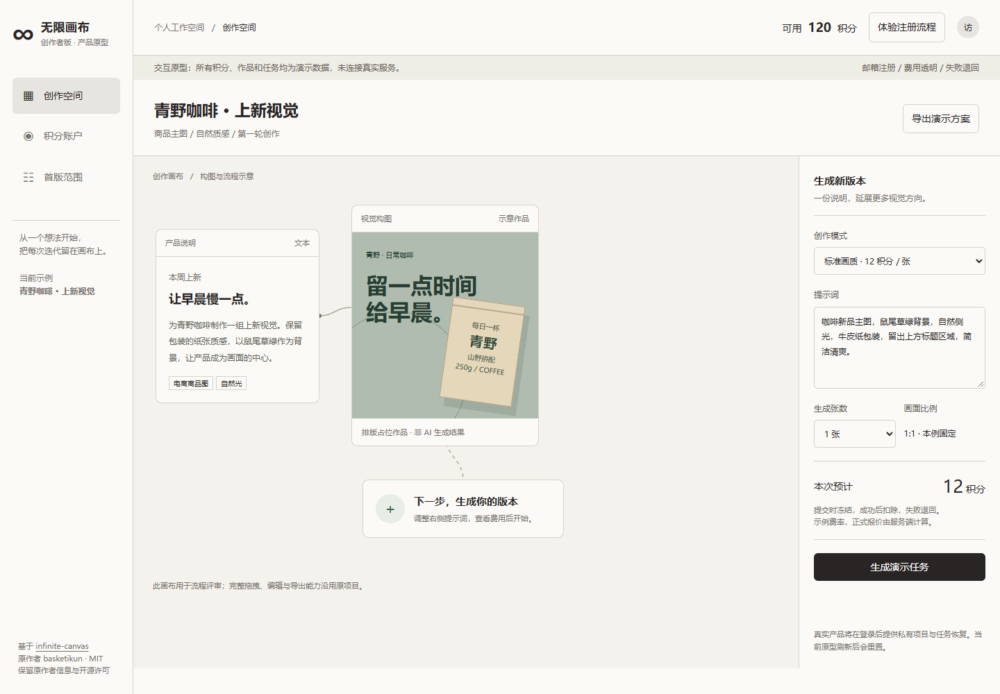
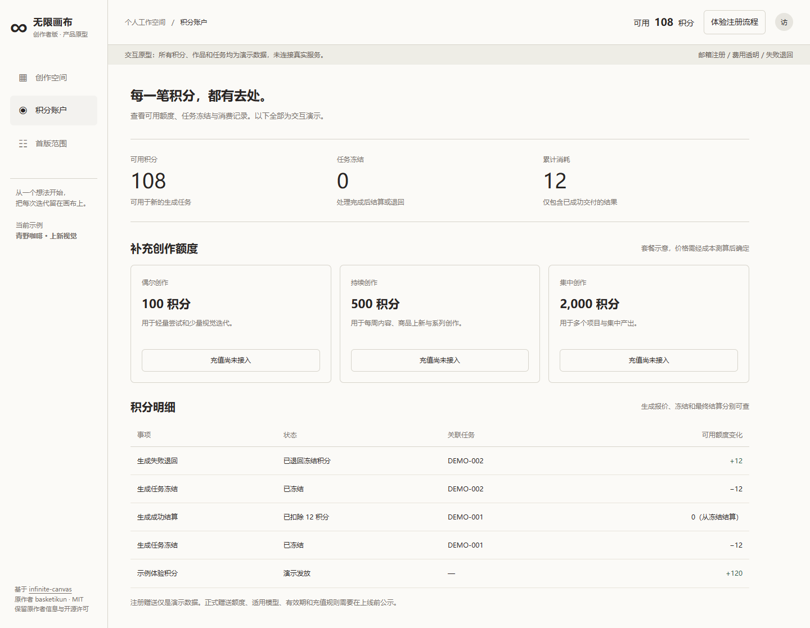

# 无限画布创作者版：二次开发评估与产品方案

**结论：适合 fork 后继续开发。保留画布前端，新建可信业务后端，才能支撑注册、积分、私有作品与收费运营。**

目标用户已确定为国内个人创作者与小团队。首版采用邮箱验证码注册及免密登录，预留手机号与微信身份绑定。此次交付为源码审查、产品与工程方案、可点击原型；真实账号、积分、充值和云端存储尚未实现，也未部署生产服务。

## 仓库与交付入口

- 已创建公开 fork：[jayson2hu/infinite-canvas](https://github.com/jayson2hu/infinite-canvas)。
- 上游：[basketikun/infinite-canvas](https://github.com/basketikun/infinite-canvas)。审查基线：`3a6b64b602ad062b29fac66902ed18a7ef5fd9dc`，根目录版本为 `v0.20.0`。
- [产品定位、用户流程、积分规则与经营方案](./PRODUCT-STRATEGY.zh-CN.md)
- [源码证据、架构、数据关系、接口与部署方案](./TECHNICAL-AUDIT.zh-CN.md)
- [账号安全、积分结算、支付与上线验收](./SECURITY-BILLING.zh-CN.md)
- [界面设计说明](./DESIGN.zh-CN.md)
- [可点击原型源码](./prototype/index.html)：下载后用浏览器打开 `index.html`；GitHub 文件页面不直接运行 HTML。

## 许可与 fork 判断

已核实根目录 [LICENSE](../../LICENSE) 为 MIT，允许修改、分发、商用和闭源使用，要求在相应副本中保留版权及许可声明。上游 [README](../../README.md) 另有保留原作者信息及前端页面标识的要求；本方案保留这些信息，并将它与 MIT 许可证正文的义务区分说明。

公开项目的 GitHub fork 为公开仓库，禁止把密钥、用户数据或商业凭证提交到仓库。如果未来希望业务代码私有维护，可另行规划遵守许可的独立私有仓库；本次没有改变公开 fork 的可见性。第三方插件、字体、模板、提示词来源和模型商业授权仍需逐项核查，主项目 MIT 不覆盖所有外部内容的权利。

建议保持自己的 `origin` 与上游 `upstream`，生产固定版本或镜像摘要，按评审吸收上游更新。上游明确提示数据格式可能变化，因此不要在生产自动追随 `latest`。现有 compose 使用上游镜像，仅修改仓库代码并不会改变该镜像的内容。

## 最重要的改造决策

| 项目 | 当前情况 | 首版决策 |
| --- | --- | --- |
| 注册登录 | 没有完整账户服务，现有 user store 只是前端状态 | 邮箱 OTP、可撤销会话、账号状态、个人工作区；手机号/微信预留身份关联 |
| 模型调用 | 浏览器保存用户 API Key 并直接调用 | 平台 Key 只在服务端，普通用户选平台模型；一切收费操作统一鉴权与计费 |
| 积分 | 没有服务端积分账本 | 服务端报价 → 事务冻结 → 队列执行 → 结果持久化 → 成功结算或确定失败释放 |
| 作品保存 | 浏览器本地，另有用户自配 WebDAV | 私有对象存储与数据库保存，前端保留缓存；项目按账户隔离与版本冲突检测 |
| 创作范围 | 生图、视频、音频、脚本、插件、Agent 等 | 首版先做图片生成与参考图编辑，保留画布、模板和导出；视频及团队协作后置 |
| 运营 | 缺少业务运营后台 | 用户、模型定价、任务、积分流水、支付订单、异常对账、补偿与审计 |
| 部署 | Docker 主要运行静态前端 | 新增业务 API、Worker、数据库、队列、私有对象存储、HTTPS 与备份 |

首版具体场景：商品视觉上新、内容封面与活动配图。用户不应为开始创作先配置 API；界面重点变为用途、效果、费用、保存状态和任务进度。新用户赠送额度采用可控活动预算，验证供应商成本前不承诺无限生成或固定人民币套餐。

## 积分必须防住的实际问题

1. 用户同时点两次、重发请求或多标签页提交：数据库幂等与原子预占保证余额不会超扣。
2. 模型已受理但网络断开：先查供应商任务和对账，不能把超时直接视为失败再重复调用。
3. 批量四张只成功两张：按可交付子任务结算，其余明确失败后释放。
4. 供应商返回成功但图片没有转存：优先恢复同一结果，不能仅凭临时链接宣告交付。
5. 用户关闭页面：服务器继续执行，回来可以恢复任务。
6. 支付回调被重复发送：核验签名、商户、金额与订单，只允许一次发分；浏览器跳转成功不发分。
7. 失败退回：回到原有付费或赠送来源，保留批次属性；不能借失败将赠分转换为可退现金的积分。

当前前端支持任意脚本和同页面权限的动态插件，本地代理允许任意目标转发。这些设计服务于个人本地工具；面向付费用户的托管版必须关闭未经审核的执行路径，并新增受控模型网关。仅隐藏按钮或把 Key 换个保存位置并不足够。

## 自部署建议

保留 React + Vite 前端。新增 TypeScript 模块化后端，建议 NestJS/Fastify、PostgreSQL/Prisma、Redis/BullMQ、私有 OSS/COS。API 与 Worker 可以来自同一代码库、分开运行；初期无需拆大量微服务，也无需为调用外部模型购买 GPU。

数据库事务保证任务、积分和订单一致，可靠出站事件将任务交给队列；队列重复投递仍需数据库幂等。公网只暴露 HTTPS 业务入口，数据库和队列走内部网络。供应商、邮件、支付的秘密只由服务端读取。

服务器规格和每月成本现在不宜报固定数值：应先取得模型实际采购价，并测量并发、平均任务时长、作品体积和下载流量。国内部署还需验证模型连接、邮件送达、支付回调，以及与运营主体和数据流向相关的适用手续；这些不因“支持 Docker”而自动解决。

## 开发顺序与粗估

估算前提：一名熟悉 TypeScript 的全栈开发，有产品和测试配合；首版只接一家供应商的图片能力。以下为规划粗估，合计约 **6–9 个开发周**，不是承诺交付日期，不包含商户开户、资质办理、采购谈判等外部等待。供应商接口不稳定、团队协作、复杂退款或大量模型会增加工作量。

| 阶段 | 粗估 | 可验收结果 |
| --- | --- | --- |
| 账户与数据基础 | 约 2 周 | 邮箱 OTP、个人工作区、数据库、私有素材、用户隔离与基本部署环境 |
| 生成任务与积分 | 约 2 周 | 一种图片能力闭环、报价预占、成功结算、失败释放、幂等与任务恢复 |
| 前端整合与受控试用 | 约 1–2 周 | 项目云保存、画布接入、积分明细、基本运营台、体验预算和成本测量 |
| 支付与上线准备 | 约 1–3 周 | 商户充值/退款、对账、备份恢复、告警、安全和异常验收 |

内测可以先通过受审计的运营额度开展，真实支付验收通过后才对外售卖。不要把模拟余额与模拟支付作为可收费版本。

实施前需要补齐的经营输入：部署区域与域名、模型供应商及商业使用条款、支付经营主体、体验活动总预算、素材保存政策。界面文案和品牌名可在这些基础上继续定稿，不影响目前已完成的分析与原型评审。

## 已验证与未验证

原型实际使用独立 Chrome 自动化浏览器检查，8 类检查通过，浏览器运行错误为 0。涵盖桌面双栏、成功冻结结算、失败全额退回、充值未接入状态、报价与余额不足、邮箱演示验证码、手机页面无横向溢出和弹窗键盘关闭。截图已进行人工视觉检查。

验证结果：[verification.json](./prototype/verification.json)。可复用 [verify.py](./prototype/verify.py)，需要 Python Playwright 及对应浏览器；已安装 Chrome 的环境可设置 `PROTOTYPE_BROWSER_CHANNEL=chrome`。

没有运行上游完整构建，也没有验证真实邮件、供应商生成、数据库事务、支付、权限隔离、并发性能或生产部署。上述生产能力在此次交付中均为设计。原型只在页面内存保存模拟身份和积分，刷新即重置。

已核对原有 TODO / Pending Tests。由于没有改动正式应用功能，其原有事项保持原状态；本规划不会被列为账号、积分或支付已实现。正式功能开发完成后，再按实际变更维护应用待办、待测试与版本记录。
