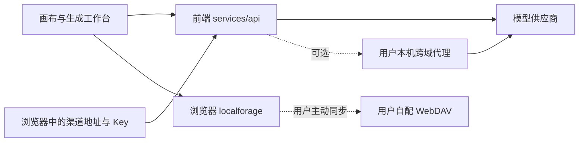
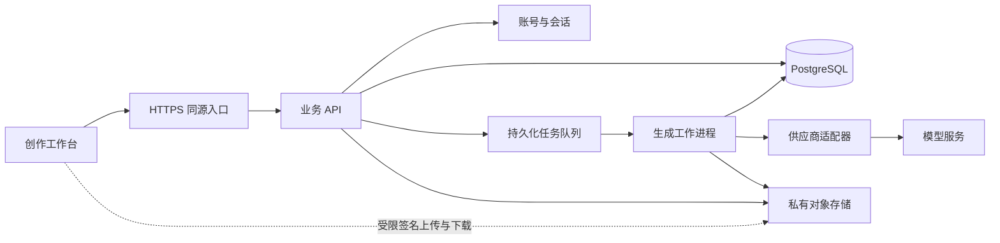

# Infinite Canvas 二次开发技术审查

本报告基于本地源码提交 `3a6b64b602ad062b29fac66902ed18a7ef5fd9dc` 的静态审查。目标用户为国内个人创作者和小团队；首期邮箱验证码注册与免密登录，身份结构预留手机号与微信；模型调用和业务后端由产品方部署。下文严格区分已有实现与建议方案，不代表功能已完成或生产环境已验证。

## 1. 技术结论

现有项目适合复用为创作工作台：React 19、Vite 7、TypeScript、Zustand、Ant Design 6，已有画布节点、多模态调用、素材管理、生成历史、主题和中英文框架。商业化改造的主体是新增服务端信任边界，而非简单增加登录弹窗与余额字段。

当前代码以浏览器本地存储、用户自带模型密钥、浏览器直连模型为基础。没有发现平台账号注册、积分账本、充值订单、组织权限和平台云存储的完整实现。仓库中的 `canvas-agent` 是本地 Agent 桥接，`canvas-proxy` 是本地跨域代理，两者都不应直接当作公网 SaaS 业务后端。

## 2. 已有能力与证据

| 领域 | 源码事实 | 二开影响 |
| --- | --- | --- |
| 技术栈 | `web/package.json:17` 起列出主要依赖 | 保留前端技术栈，避免整体重写 |
| 页面路由 | `web/src/router.tsx:15` 配置首页、图片、视频、素材、提示词、画布和配置页 | 需要新增账号、积分、订单和运营路由，以及页面级会话初始化；后端仍须独立鉴权 |
| 用户状态 | `web/src/stores/use-user-store.ts:14` 只有 `user: null` 与 `clearSession` | 名称含 user 不代表具备真实登录能力 |
| 渠道凭据 | `web/src/stores/use-config-store.ts:20` 定义 `baseUrl/apiKey`；`:216` 的持久化配置保存 `config/webdav` | SaaS 平台模型密钥必须迁至服务端，不进入前端配置、构建变量或运行期公开配置 |
| 图片调用 | `web/src/services/api/image.ts:694`、`:754` 处理生图与编辑；`:319` 构造 Bearer；`:728` 请求模型服务 | 可保留业务入口函数，将平台模式接到自己的生成任务 API |
| 视频调用 | `web/src/services/api/video.ts:72` 创建任务、`:82` 查询；`:185` 创建供应商任务；`:195` 轮询供应商 | 需要持久化任务、工作进程与重启恢复，不能依赖浏览器一直打开 |
| 音频与文本 | `web/src/services/api/audio.ts:23`、`web/src/services/api/image.ts:821` 为入口 | 积分覆盖面必须包含音频、文字、编辑等所有收费动作 |
| 画布调用入口 | `web/src/pages/canvas/project.tsx:321` 视频，`:2477` 图片，`:2613` 音频，`:2664` 文本 | 单改首页生成按钮会遗漏画布内的收费路径 |
| 独立工作台入口 | `web/src/pages/image/index.tsx:324`、`web/src/pages/video/index.tsx:187` | 应统一经过服务层，避免多个页面各自实现余额与扣费 |
| 插件调用入口 | `web/src/pages/canvas/hooks/use-plugin-host.tsx:57`、`:76`、`:83` 提供图片、视频、文本生成 | 也必须统一通过服务端鉴权、计价和任务编排 |
| 项目数据 | `web/src/stores/canvas/use-canvas-store.ts:10` 定义项目；`:43` 是固定本地存储键；`:134` 使用本地持久化 | 现有类型没有租户归属与服务端 revision，新增账号后需防止同一浏览器不同账号串数据 |
| 素材数据 | `web/src/stores/use-asset-store.ts:15` 定义素材；`:45` 是固定存储键；`:107` 使用本地持久化 | 元数据迁至数据库，媒体迁至私有对象存储，本地作为缓存 |
| 媒体文件 | `web/src/services/image-storage.ts:17` 与 `web/src/services/file-storage.ts:8` 使用 localforage | 浏览器清理、换设备、存储配额会影响可用性；浏览器地址不能替代平台持久化资产 ID |
| WebDAV | `web/src/services/app-sync.ts:84` 同步画布、资产和工作台记录；`web/src/services/webdav-sync.ts:75` 从浏览器携带 Basic 凭据请求自配 WebDAV | 已有的是用户自配 WebDAV 同步，不是平台账号云同步，也不是实时协作 |
| WebDAV 合并 | `web/src/services/app-sync.ts:298` 合并删除标记；`:324` 按 ID 和时间戳选择记录 | 不能直接承担多人并发编辑；资产删除同步也有现有范围限制，见 `docs/content/docs/progress/pending-test.zh-CN.mdx:87` |
| 本地 Agent | `canvas-agent/src/server/http.ts:126` 使用本地连接 token；`:434` 仅监听 `127.0.0.1` | 无多租户平台账户隔离，不应公网暴露用户机器操作能力 |
| 本地代理 | `canvas-proxy/index.js:8` 允许广泛 CORS；`:35` 解析任意目标；`:78` 转发并跟随重定向；`:127` 默认本机监听 | 不应换成公网地址当模型网关；生产网关只允许运营方配置的模型供应商 |
| 模型脚本 | `web/src/services/api/model-plugin.ts:118` 使用 `new Function` 并注入 API Key | 自助脚本执行不适合直接复用到携带付费会话的产品界面，更不能原样迁到服务器执行 |
| 画布插件 | `web/src/lib/canvas/plugin-loader.ts:12`、`:15` 将源码转为 Blob 后动态 import | 插件在主页面权限内执行；上游 `SECURITY.md` 明确说明可读取页面数据与本地 Key |
| Docker | `Dockerfile:13` 起仅运行 Nginx；`nginx.conf:7` 仅提供 SPA 静态路由回退 | 当前镜像不会创建账户 API、数据库或任务队列 |
| 容器镜像来源 | `docker-compose.yml:3` 使用上游 `latest` 镜像 | Fork 后需构建自己的版本镜像，否则仍运行上游代码；生产应固定版本或镜像摘要 |

## 3. 当前调用链与改造后的边界

当前：

建议：

建议采用一个模块化后端加一个工作进程，而非首期拆分多个微服务。具体建议为 TypeScript + NestJS（Fastify 适配器）、PostgreSQL + Prisma、Redis + BullMQ，以及国内私有 OSS/COS 对象存储。后端与工作进程复用业务模块，按运行角色拆进程；Prisma 管理表结构和常规查询，账务并发控制明确采用数据库行锁或条件更新，不能用普通先读余额再写余额代替事务。

PostgreSQL 是任务、订单、积分的权威数据源，Redis 只承担队列和可重建的缓存。BullMQ 按至少一次投递设计：同一消息可能重复处理，不能宣传为“天然只执行一次”。业务事务同时写冻结记录、任务和 outbox；分发器把 outbox 发布到队列，发布与确认之间即使崩溃也允许重发；工作进程通过数据库任务状态、执行租约和唯一约束拒绝重复的有效结算。供应商调用位于数据库事务之外，不长期占用账本锁。

队列去重只能减少重复消息，不能消除“供应商已受理但工作进程尚未保存响应”的窗口。应优先选择支持幂等请求键与任务查询的供应商；无法判断是否受理时进入待核对状态，禁止因租约超时盲目再生成。

### 服务端模块

1. **身份与会话**：用户、已验证身份、邮箱验证码挑战、会话、登录审计。身份表使用 `provider/subject/user_id`，邮箱、手机、微信都绑定同一个用户；敏感身份变更需重新验证当前邮箱及新身份，后续账号合并必须确认双方身份。密码登录与密码重置不在首期范围。
2. **工作区与权限**：每个注册用户先创建个人工作区；项目、资产、任务、钱包都挂 `workspace_id`。团队邀请与成员角色可以后续开放，但服务端租户边界从第一版确定。
3. **模型目录与报价**：前端只提交平台 `model_id` 和合法参数。可用渠道、Key、上游模型名称与成本留在服务端；前端提交的价格、余额、供应商 URL 都不可信。
4. **生成任务**：输入引用、参数快照、价格版本、供应商任务 ID、结果资产、错误分类和审计关联。任务进度通过查询或 SSE 提供，刷新或离开页面后仍可恢复。
5. **积分与订单**：余额、冻结额度、不可变流水、赠送批次、订单、支付事件与退款。实际支付接入完成验签、对账、退款流程后再开放购买。
6. **资产与项目**：数据库保存元数据和项目结构，对象存储保存媒体；对象引用带工作区归属，签名 URL 不是资源所有权凭证。
7. **运营台**：模型上下架和定价、任务异常处理、用户冻结、人工赠分、订单与流水查询。每个管理动作记录操作者与原因。

### 建议表关系

以下是逻辑结构建议，尚未生成或验证数据库迁移；账本分录细节以 [安全与积分方案](./SECURITY-BILLING.zh-CN.md) 为准。

| 主要表组 | 关系与关键约束 |
| --- | --- |
| `users`、`auth_identities`、`sessions`、`email_challenges` | 用户拥有多个身份和会话；`(provider, subject)` 唯一；验证码挑战绑定邮箱、用途和请求上下文，保存带服务端密钥保护的摘要、过期与已使用状态，不保存明文验证码 |
| `workspaces`、`workspace_members` | 用户创建个人工作区；成员 `(workspace_id, user_id)` 唯一，角色与状态由后端判定 |
| `projects`、`project_revisions` | 项目属于工作区；revision 单调递增，保存时核对客户端基线，历史版本保留恢复入口 |
| `assets`、`project_asset_refs` | 资产属于工作区，保存对象键、校验摘要、大小、类型和状态；项目引用必须与资产工作区匹配 |
| `model_catalog`、`price_versions`、`quotes` | 公共模型 ID 映射服务端供应商；报价记录版本、参数摘要、工作区和额度，不包含可泄露的渠道凭据 |
| `generation_jobs`、`job_attempts` | 作业属于工作区和发起用户，关联报价；批量请求拆成关联批次的独立子任务，每个子任务可独立交付与结算；供应商受理 ID 和请求幂等键可追溯 |
| `wallets`、`credit_reservations`、`credit_ledger`、`credit_grants` | 每个工作区拥有独立钱包，保存 `available/held`；冻结绑定独立子任务；流水不可变并绑定业务事件唯一键；赠送与付费来源分开追踪 |
| `payment_orders`、`payment_events`、`refunds` | 订单属于工作区；供应商支付事件 ID 唯一；支付订单金额与积分商品快照不可依赖回调中的自报值 |
| `outbox_events`、`audit_logs` | outbox 与业务修改在同一事务提交；审计记录主体、动作、对象和原因，敏感值脱敏 |

所有媒体和任务查询均从会话解析用户并校验工作区成员资格，不接受客户端指定用户身份。涉及积分和人民币的值使用整数单位或数据库精确定点数，不使用浮点数；超出 JavaScript 安全整数范围的值通过十进制字符串传输。

### 建议 API 契约

接口为待实现的首版契约示意，不代表现在可以调用。以下路径统一位于同源 `/api/v1`，生产使用 HTTPS 与 HttpOnly/Secure 会话 Cookie，并校验需要的 CSRF/Origin 条件。

| 接口组 | 路径示意 | 关键行为 |
| --- | --- | --- |
| 邮箱验证码 | `POST /auth/email/request-code`、`POST /auth/email/verify` | 验证成功后完成首次注册或免密登录；控制发送与验证尝试，单次消费；外部响应避免泄露邮箱是否注册，首次赠分以独立幂等约束控制 |
| 会话与敏感变更 | `POST /auth/logout`、`GET /me`；敏感变更复用带专用用途的邮箱验证挑战 | 成熟鉴权库管理可撤销会话；更换邮箱或绑定新身份前重新验证当前邮箱，并验证新身份；手机号与微信首期只预留身份结构 |
| 模型目录 | `GET /models` | 返回可用模型、支持参数与用户可见计价说明，不返回供应商 Key |
| 报价 | `POST /generation-quotes` | 提交 `workspaceId/modelId/params/inputAssetIds`，返回 `quoteId/priceVersion/estimatedCredits` 等报价信息 |
| 创建任务 | `POST /generation-jobs` | 携带 `Idempotency-Key`，提交 `quoteId/projectId/nodeId` 与输入快照；后端复核引用权限和参数摘要，受理后返回任务 ID |
| 状态与取消 | `GET /generation-jobs/:id`、`GET /generation-jobs/:id/events`、`POST /generation-jobs/:id/cancel` | 返回状态、结果资产和账务状态；取消请求不代表已成功退款 |
| 项目 | `GET/POST /projects`、`GET/PATCH /projects/:id` | 更新携带基线 revision；冲突返回明确错误和服务器版本，不静默覆盖 |
| 资产 | `POST /assets/upload-intents`、`POST /assets/:id/complete`、`GET /assets/:id/download-url` | 创建受限上传意图，上传完成后服务端验证对象；每次下载签名先检查权限 |
| 积分 | `GET /credits/balance`、`GET /credits/transactions` | 展示可用、冻结和流水；前端没有任意加减积分接口 |
| 购买与回调 | `POST /orders`、`GET /orders/:id`、`POST /payments/:provider/webhook` | 浏览器仅创建和查询订单；验签后的支付事件驱动入账，回调校验保留原始请求体 |
| 管理 | `/admin/models`、`/admin/users`、`/admin/jobs`、`/admin/credit-adjustments` | 独立管理员鉴权；调整积分需指定原因并产生账本分录，不直接改余额 |

相同工作区、接口和幂等键只能对应同一请求摘要；同键不同参数返回冲突。常规错误统一返回 `code/message/requestId`，例如 `INSUFFICIENT_CREDITS`、`QUOTE_STALE`、`PROJECT_REVISION_CONFLICT`、`JOB_RECONCILING`。返回用户可处理的中文说明，供应商原始错误和调试细节仅进入脱敏日志。

## 4. 不能只做前端扣积分

服务端接收幂等键后，应在数据库事务中完成权限检查、报价验证、额度冻结、任务写入；工作进程调用供应商，结果入库并保存可交付媒体后结算，明确失败后解冻。余额查询和扣减需在并发下保持一致，账本必须可由流水对账。

关键异常需要单独建模：

| 情况 | 正确处理方向 |
| --- | --- |
| 用户连点或请求重试 | 同一幂等键返回同一任务，不重复冻结与调用 |
| 供应商成功，浏览器断开 | 服务器继续保存结果与结算，用户重新进入可查看 |
| 供应商请求超时，但是否受理未知 | 状态进入待核对，查询供应商记录后处理；不能立即退分后无条件再次调用 |
| 用户取消本地等待 | 不等同于供应商取消；只有服务端确认取消结果，才能决定释放额度 |
| 回调重复或乱序 | 依靠任务状态机和唯一约束，仅允许一次有效结算 |
| 批量四张成功两张 | 逐项记录结果与价格，按事先展示的计费规则结算成功部分并释放失败部分 |
| 已扣供应商成本但文件下载失败 | 重试取回同一结果，不盲目重新生成；超过可恢复范围后按产品规则人工处理 |
| 充值回调早于浏览器回跳，或回调重放 | 支付验签、订单金额和收款主体核对后入账；浏览器跳转成功页面不能直接增加余额 |
| 价格在任务执行中变更 | 保留受理时价格版本与报价快照，历史账目不得随当前模型价格重算 |

以上是要实现和验证的设计，不代表当前仓库已经具有这些能力。积分倍率、赠送额度、过期方式、并发、文件大小、超时和重试上限应作为产品参数评审；本报告不擅自固化具体默认值。

## 5. 前端最小改造路径

1. 在 `services/api` 增加自己的会话、项目、资产、模型目录、报价、生成任务、钱包与订单客户端；以统一错误码映射中文提示。
2. 将图片、视频、音频、文字的公共生成入口接到任务 API，覆盖普通工作台、画布重试、批量节点和插件宿主路径。收费判断只在服务端执行。
3. 配置页对普通用户展示可用模型与偏好；平台渠道 Key 和任意调用脚本编辑迁到受限运营流程。首期关闭用户上传任意脚本和远程插件入口，并阻止旧持久化插件在启动时自动执行。`plugin-loader.ts:129` 起的本地发现流程也会先执行源码再写入禁用状态，必须约束发现与执行路径，不能只隐藏插件按钮。
4. 新增账号入口、积分余额、预计消耗、冻结/扣除/退回记录、任务恢复和失败原因。保存状态明确区分“本地暂存”“云端已保存”“待同步”“冲突待处理”。
5. 保留 IndexedDB 快速编辑体验，但缓存按用户及工作区隔离。切换账号时停止旧请求和订阅，清空旧身份的内存状态，防止迟到响应写入新账号。
6. 项目保存采用服务器 revision 和条件更新，冲突时保留双方版本并提示；首期无需实时多人光标与 CRDT。新增账号后的本地项目导入应让用户选择归属，不能把同机已有项目自动上传到首个登录账号。
7. 服务端资产 ID 成为项目引用，`blob:` 只用于浏览器预览；长期数据不保存会过期的供应商 URL 或签名 URL。下载时按权限获取新的地址。

`web/src/pages/canvas/project.tsx` 已承担较多流程。首批改造宜优先收敛到 API 服务层，再按真实复用需求提取任务控制 hook；避免为了商业化整体替换画布组件。

HttpOnly Cookie 能减少凭据被脚本直接读取的风险，但不能阻止已在主页面运行的恶意插件借用户会话发起请求，因此不能以 Cookie 方案替代插件权限收敛。将来确需第三方插件时，应采用独立来源的受限执行环境与最小化消息协议，单独评估可用能力。

## 6. 部署需要新增的内容

- 自有 Docker 镜像、API 容器、Worker 容器、数据库，以及按选型提供的队列。数据库和对象存储需要独立持久化、备份和恢复验证。
- HTTPS 域名及同源 `/api` 反向代理；SSE 禁止代理缓冲，并在上线测试中验证网络断开和重连。
- SMTP 或国内可用的邮件服务及域名送信配置；验证码注册、免密登录、敏感身份变更的重新验证和送达失败均需走完整流程。
- 私有对象桶、受控跨域、签名上传后的服务端确认、文件类型与归属校验。对用户提供的外部 URL 下载需限制目标与重定向，防止请求内部服务。
- 密钥使用运行环境或秘密管理服务注入，仅服务端读取；日志不记录明文凭据、验证码或含 Key 的完整 URL。
- 上线探针、结构化日志、供应商延迟/失败率、任务积压、冻结额度未结算告警、日对账、备份恢复与版本回滚。
- 管理界面独立权限与操作审计；数据库或缓存异常时暂停新收费任务，不能继续调用上游却无法记录账务。

当前 `web/vite.config.ts:42` 支持设置构建 base，但路由初始化没有配置 basename，插件发现使用 `/plugins/index.json` 等根路径。根域名部署与子路径部署都需要实际验证，不能仅凭 Vite base 参数宣称支持任意子路径。`AGENTS.md:95` 也明确提示 Docker 静态资源路径仍需核验。本次未构建、启动容器或执行生产部署验收。

## 7. 开发验收应覆盖的业务证据

| 验收主题 | 必须证明的结果 |
| --- | --- |
| 邮箱与会话 | 验证码注册与免密登录、重复验证、敏感身份变更的重新验证、注销和失效会话可正确处理；账号 A 无法读取账号 B 的数据 |
| 并发扣费 | 并发生成不会超扣或负余额；重复提交、重复回调仅产生一次有效扣费 |
| 未知供应商结果 | 超时、Worker 重启、网络断开不会造成静默重复生成和重复账目 |
| 数据权限 | 修改项目 ID、资产 ID、工作区 ID、任务 ID 均不能跨租户访问 |
| 多入口计费 | 图片、编辑、视频、文本、音频、画布重试与批量生成都走统一服务端路径 |
| 浏览器恢复 | 刷新、换设备后可找回云端项目与任务；账号切换不会显示前一账号缓存 |
| 存储交付 | 供应商临时 URL 失效后，已成功交付素材仍能访问；签名过期可重新授权 |
| 订单 | 重放、篡改金额、伪造成功页、乱序回调不会错误加分；退款与账本一致 |
| 插件边界 | 普通用户不能通过脚本、插件或自定义地址调用平台秘密或越过配额 |
| 运维恢复 | 从备份恢复后，订单、账本、任务和媒体元数据可对账；上线回滚有可用版本 |

## 8. 技术实施顺序与排期口径

开发周估算以 [产品方案](./PRODUCT-STRATEGY.zh-CN.md) 及交付总览为准，不承诺固定上线日期。估算前提应明确开发人员熟悉 TypeScript、有产品与测试配合，首期先闭环一个供应商的图片生成与编辑；视频、音频和高级 Agent 能力沿用同一架构按后续批次接入。

| 阶段 | 技术产物 | 进入下一阶段的证据 |
| --- | --- | --- |
| 基线与部署骨架 | 自有镜像、后端模块、数据库迁移、配置与 CI、故障日志 | 干净环境可启动；秘密不进入前端；部署可回滚 |
| 身份与私有数据 | 邮箱身份、会话、个人工作区、项目 revision、私有媒体 | 账号隔离及权限篡改验收通过 |
| 生成与账本闭环 | 一个供应商适配、报价、冻结、任务、outbox、结果保存和结算 | 并发、重复投递、超时未知、Worker 重启与恢复验收通过 |
| 运营与内测 | 用户与任务查询、人工赠分、告警与对账、邀请用户内测 | 真实低额度调用的成本、交付成功率与争议流程可核对 |
| 支付与上线 | 订单、支付回调、退款、服务条款与客服入口、恢复演练 | 支付异常验收、账本日对账、备份恢复和上线清单通过 |

支付开户、域名备案、邮件送达审批与相关上线资质可能独立影响日历时间，应单独跟踪。许可证及品牌使用范围以相应审查结论为准。本报告没有生成未经验证的 Docker Compose、生产秘密配置或数据库迁移。

本轮仅新增技术审查文档，没有修改产品功能或现有待办完成状态；已阅读 `todo.mdx`、`todo.zh-CN.mdx` 与 `pending-test.zh-CN.mdx`，无需将任何事项标记为已实现或待用户验收。
